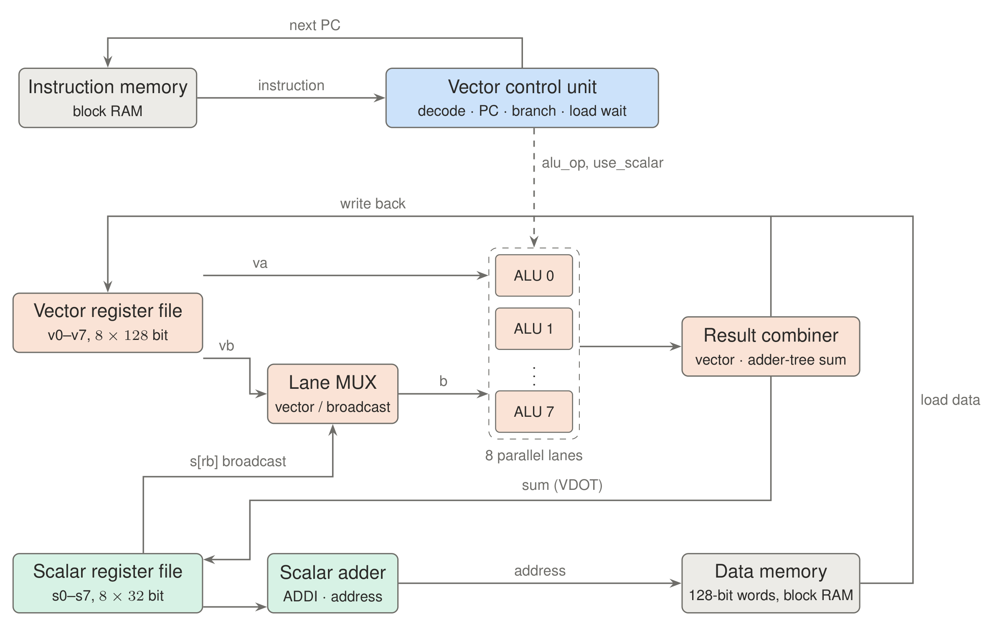

# SIMD Vector Processing Unit

[](https://github.com/mahir-m01/SIMD-Vector-Processing-Unit/actions/workflows/ci.yml)
[](rtl)
[](https://steveicarus.github.io/iverilog/)
[](https://www.veripool.org/verilator/)
[](https://github.com/YosysHQ)
[](syn)
[](LICENSE)


A parameterised SIMD vector processing unit in Verilog: eight 16-bit lanes, a 22-instruction ISA, cycle-exact verification against a Python golden model, and a scalar-versus-SIMD comparison on FPGA.

## Overview

Image filters, audio, neural networks and physics codes repeat the same arithmetic over long arrays. A scalar processor fetches, decodes and runs one instruction per element. A **SIMD** (Single Instruction, Multiple Data) processor runs one instruction on a whole group of elements at once: one control decision drives several calculators ("lanes") working side by side.

This project builds such a unit, checks it thoroughly, and measures what it gains. Setting the lane count to 1 turns the same design into an ordinary scalar processor. The scalar baseline therefore runs the **same program** with the **same instructions** and the **same timing rules**, and any difference comes from data-level parallelism alone.

## Objectives

- Design a SIMD unit with the blocks named in the brief: vector register file, parallel ALUs, vector control unit, lane MUXes, result combiner and a scalar interface.
- Support vector ADD, SUB, AND, OR, XOR, comparisons, shifts, multiply, min and max, plus a dot-product reduction.
- Verify every lane and every instruction with self-checking testbenches and a golden model.
- Compare scalar and SIMD versions of the same workloads: cycle count, throughput and speed-up.
- Report FPGA resource use and maximum clock frequency for 1, 2, 4 and 8 lanes.

## Architecture

<p align="center"></p>

| Block | File | Role |
| --- | --- | --- |
| Vector control unit | [`vec_control_unit.v`](rtl/vec_control_unit.v) | Decodes instructions, chooses the next PC, adds the extra cycle for loads |
| Vector register file | [`vec_regfile.v`](rtl/vec_regfile.v) | 8 × 128-bit registers, 2 read + 1 write port |
| Scalar register file | [`scalar_regfile.v`](rtl/scalar_regfile.v) | 8 × 32-bit registers, `s0 = 0`, debug port for the host |
| Lane MUX | [`lane_mux.v`](rtl/lane_mux.v) | Operand B per lane: vector element or broadcast scalar |
| Parallel ALUs | [`vec_alu_lane.v`](rtl/vec_alu_lane.v), [`vec_alu_array.v`](rtl/vec_alu_array.v) | 8 copies of a 14-operation 16-bit ALU |
| Result combiner | [`result_combiner.v`](rtl/result_combiner.v) | Lane results as a vector, plus an adder-tree sum for reductions |
| Core / FPGA top | [`simd_core.v`](rtl/simd_core.v), [`fpga_top.v`](rtl/fpga_top.v) | Integration and performance counters; block-RAM memories and board pins |

- **One instruction per clock cycle.** Loads take two cycles, because block RAM answers one clock after the address. Branches cost nothing extra. So cycles = instructions + loads, exactly.
- **128-bit vectors**: the width of Intel SSE and ARM NEON.
- **Compares write all-ones masks**, so an `if` can run without a branch.

Full walkthrough: [`docs/architecture.md`](docs/architecture.md) · instruction set: [`docs/isa.md`](docs/isa.md) · block notes: [ALUs](docs/alu.md), [register files](docs/register_files.md), [lane MUX and combiner](docs/lane_mux_and_combiner.md)

```asm
loop:   VLD  v1, A(s1)        # load 8 elements of A
        VLD  v2, B(s1)        # load 8 elements of B
        VADD v3, v1, v2       # 8 additions in one instruction
        VST  v3, C(s1)
        ADDI s1, s1, 1
        BNE  s1, s2, loop
```

## Status

Phase 1 is being built block by block. Each block has an issue with its interface, checklist and definition of done; see the [issues](https://github.com/mahir-m01/SIMD-Vector-Processing-Unit/issues). Every pull request runs lint and all tests that exist so far.

| Part | Status |
| --- | --- |
| Architecture, ISA, shared definitions, CI | done |
| Lane ALU and parallel ALU array | in progress |
| Vector and scalar register files | in progress |
| Lane MUX and result combiner | in progress |
| Assembler, golden model and workloads | in progress |
| Control unit, core integration, system testbench | in progress |
| FPGA synthesis, scalar-vs-SIMD analysis, report | planned |

## Building and testing

Requires [Icarus Verilog](https://steveicarus.github.io/iverilog/), [Verilator](https://www.veripool.org/verilator/) and Python 3.10+.

```bash
brew install icarus-verilog verilator      # macOS; on Ubuntu: apt install iverilog verilator
make lint      # Verilator -Wall on every module
make test      # every testbench and check that exists so far
```

## Repository structure

```text
SIMD-Vector-Processing-Unit/
├── rtl/                  synthesizable Verilog: core, lanes, register files, control, FPGA top
├── tb/                   self-checking testbenches and the verification plan
├── sw/                   assembler, golden model, workload programs, runner, plots, tests
│   └── programs/         vadd, saxpy, relu, threshold, dot, isa_test
├── syn/                  FPGA synthesis sweep (ECP5, Artix-7) and the Vivado flow for Basys-3
├── results/              perf.csv, fpga_ecp5.csv, fpga_artix7.csv and figures
├── docs/                 architecture, instruction set and one page per hardware block
├── reports/              Phase 1 report (PDF and LaTeX source) and references
├── .github/workflows/    lint and tests on every push and pull request
└── Makefile              make test | perf | syn | plots | report
```


## Roadmap

| Phase | Focus |
| --- | --- |
| Phase 1 | RTL, verification, scalar-vs-SIMD cycle comparison, ECP5 resources and Fmax |
| Phase 2 | Pipelined core for higher Fmax; exact Vivado results and a Basys-3 board run; masked (predicated) execution and saturating arithmetic; speed-up against problem size; power estimates; final report |

## Acknowledgements

Developed as a semester project. Simulation with Icarus Verilog, lint with Verilator, synthesis and place-and-route with Yosys and nextpnr (Project Trellis for ECP5).
